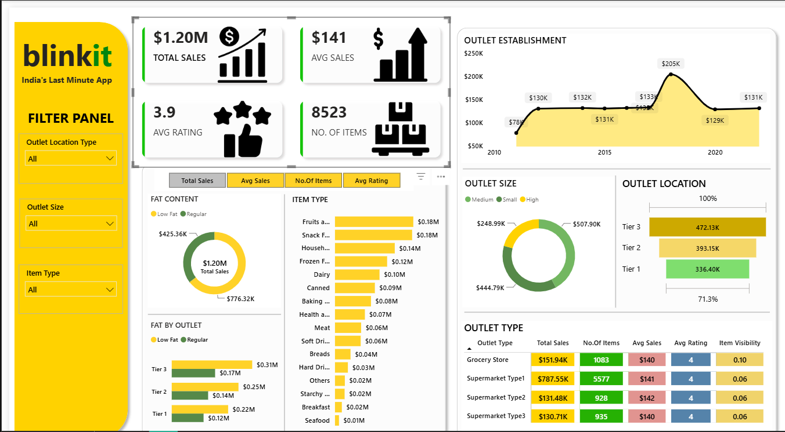

# Blinkit Grocery Sales Dashboard — Power BI

An interactive Power BI dashboard that analyzes Blinkit grocery sales data to find which products, outlets and locations bring in the most sales.



## About the Project

Blinkit is an Indian quick-commerce grocery app. In this project I cleaned 8,500+ rows of Blinkit sales data in Power Query, created DAX measures, and built a one-page interactive dashboard. It shows sales by product type, fat content, outlet size, outlet type, city tier and outlet opening year.

## Tools Used

| Tool | Used for |
|---|---|
| Excel | Raw dataset |
| Power Query | Data cleaning and data types |
| DAX | KPI measures |
| Power BI | Dashboard and charts |

## Dataset

| Detail | Value |
|---|---|
| Rows (sales records) | 8,523 |
| Unique products | 1,559 |
| Item categories | 16 |
| Outlets | 10 |

**Main columns:** Item Type, Item Fat Content, Outlet Size, Outlet Location Type, Outlet Type, Outlet Establishment Year, Item Visibility, Sales, Rating.

## Data Cleaning (Power Query)

1. Promoted the first row to column headers.
2. Set the correct data type for each column (text, whole number, decimal number).
3. Fixed inconsistent labels in **Item Fat Content**:
   - "LF" and "low fat" → **Low Fat**
   - "reg" → **Regular**

   After cleaning, the column has only 2 values: Low Fat (5,517 rows) and Regular (3,006 rows).
4. Set **Rating** as a decimal number so ratings like 4.3 are not rounded down to 4.

## DAX Measures

```DAX
Total Sales = SUM('BlinkIT Grocery Data'[Sales])
Avg Sales   = AVERAGE('BlinkIT Grocery Data'[Sales])
No.Of Items = COUNTROWS('BlinkIT Grocery Data')
Avg Rating  = AVERAGE('BlinkIT Grocery Data'[Rating])
```

**Field parameter:** a `Metrics` table holds all four measures. It powers the buttons at the top of the charts, so one chart can switch between Total Sales, Avg Sales, No. of Items and Avg Rating.

## KPIs

| KPI | Value |
|---|---|
| Total Sales | $1.20M |
| Average Sales | $141 |
| No. of Items (sales records) | 8,523 |
| Average Rating | 3.97 |

## Dashboard Features

- **KPI cards** – Total Sales, Avg Sales, Avg Rating, No. of Items
- **Metric buttons** – switch charts between the four measures (field parameter)
- **Fat Content** – donut chart
- **Fat by Outlet** – clustered bar chart (Low Fat vs Regular in each tier)
- **Item Type** – bar chart of all 16 categories
- **Outlet Establishment** – line chart of sales by opening year
- **Outlet Size** – donut chart
- **Outlet Location** – funnel chart (Tier 1, 2, 3)
- **Outlet Type** – matrix table with Total Sales, No. of Items, Avg Sales, Avg Rating and Item Visibility
- **Filter panel** – slicers for Outlet Location Type, Outlet Size and Item Type

## Key Insights

1. **Tier 3 cities bring the most sales:** $472K, about 39% of total sales.
2. **Supermarket Type1 is the biggest outlet type:** $788K, about 65% of total sales.
3. **Fruits & Vegetables ($178K) and Snack Foods ($175K)** are the top-selling categories.
4. **Low Fat products** make up about 65% of sales ($776K).
5. **Medium-size outlets** bring the most sales: $508K, about 42%.
6. Outlets opened in **2018** have the highest sales ($205K).
7. **Customer ratings are almost the same** across all outlet types (around 4.0), so outlet type does not change customer satisfaction much.

## Files in this Repository

| File | Description |
|---|---|
| `Blinkit_Dashboard.pbix` | Power BI dashboard file |
| `BlinkIT_Grocery_Data.xlsx` | Raw dataset |
| `dashboard.png` | Dashboard screenshot |

## How to Open

1. Download or clone this repository.
2. Install **Power BI Desktop** (free) from Microsoft.
3. Open `Blinkit_Dashboard.pbix`.
4. If Power BI cannot find the data, go to **Transform data → Data source settings → Change Source** and select `BlinkIT_Grocery_Data.xlsx` from the downloaded folder.

## Author

**Pawan Jangid** – MCA (Cyber Security), JECRC University
